# PKI privada como código: step-ca, ACME, mTLS y certificados de 24 horas

**🇺🇸 [Read in English](README.md)**

Lab práctico donde construí mi propia **autoridad certificadora (CA) privada de dos niveles** en una VM con Kali Linux usando [Smallstep `step-ca`](https://smallstep.com/docs/step-ca/). Emití **certificados de vida corta (24 horas)** de forma automática con **ACME**, protegí un servicio Nginx con **TLS mutuo (mTLS)**, automaticé la **renovación**, hice un **simulacro de caída de la CA** y agregué **monitoreo de expiración y salud** con alertas.

> Hecho por Daniel Rocha (noviembre 2026), Senior Technical Support Engineer (SSL/TLS y PKI) en transición a Security Engineering.
> Todo corre en local y sin costo (VMware + Kali Linux, herramientas de código abierto).

---

## Contenido

1. [Por qué este proyecto](#1-por-qué-este-proyecto)
2. [Resultados](#2-resultados)
3. [Arquitectura](#3-arquitectura)
4. [Entorno del lab](#4-entorno-del-lab)
5. [Paso a paso (comandos explicados + evidencias)](#5-paso-a-paso)
6. [Decisiones de diseño](#6-decisiones-de-diseño)
7. [Notas de seguridad](#7-notas-de-seguridad)
8. [Problemas y lecciones aprendidas](#8-problemas-y-lecciones-aprendidas)
9. [Próximos pasos](#9-próximos-pasos)
10. [Estructura del repositorio](#10-estructura-del-repositorio)

---

## 1. Por qué este proyecto

Los certificados TLS públicos duran cada vez menos: el CA/Browser Forum aprobó un calendario (Ballot SC-081) que reduce por etapas la vida máxima de los certificados hasta **47 días**. Las organizaciones que todavía renuevan a mano van a tener caídas. La respuesta es la **automatización**: certificados de vida corta, emitidos y renovados por máquinas, con monitoreo.

Trabajo con PKI pública todos los días, y quería demostrar que puedo **diseñar y operar una PKI de punta a punta**, no solo darle soporte:

- Construir la jerarquía (raíz + intermedia) y entender **por qué** se construye así.
- Operar mi propia CA y emitir certificados automáticamente con el mismo protocolo que usa Let's Encrypt (ACME).
- Usar esos certificados en un servidor web real, incluyendo **mTLS** (autenticación de clientes sin contraseñas).
- Automatizar la renovación y **probar qué pasa cuando la CA se cae**.
- Monitorear la expiración y la salud de la CA para que las fallas no sean silenciosas.

## 2. Resultados

| Capacidad | Estado | Prueba |
|---|---|---|
| PKI de dos niveles (raíz ECDSA P-256 de 10 años + intermedia de 5 años) | ✅ | [Evidencia 02](#paso-2--construir-la-pki-de-dos-niveles-raíz--intermedia) |
| `step-ca` funcionando con **mi propia** raíz e intermedia (sin la clave raíz en la CA) | ✅ | [Evidencias 05–06](#paso-3--inicializar-step-ca-y-cargar-mi-propia-pki) |
| Certificados de 24 horas | ✅ | [Evidencias 07–08](#paso-5--primer-certificado-24-horas) |
| Emisión por ACME (HTTP-01), sin contraseñas | ✅ | [Evidencia 08](#paso-6--acme-emisión-automática-con-http-01) |
| Nginx con HTTPS de la CA privada + almacén de confianza | ✅ | [Evidencias 11–12](#paso-8--usar-el-certificado-en-nginx-https) |
| **mTLS**: rechaza sin certificado de cliente y acepta con él | ✅ | [Evidencia 14](#paso-9--tls-mutuo-mtls) |
| Renovación automática + recarga de Nginx | ✅ | [Evidencias 15–17](#paso-10--renovación-automática) |
| Simulacro de caída de la CA | ✅ | [Evidencia 18](#paso-11--simulacro-de-caída-de-la-ca) |
| Monitoreo de expiración y salud de la CA cada 5 minutos | ✅ | [Evidencias 20–22](#paso-12--monitoreo-y-alertas) |

## 3. Arquitectura

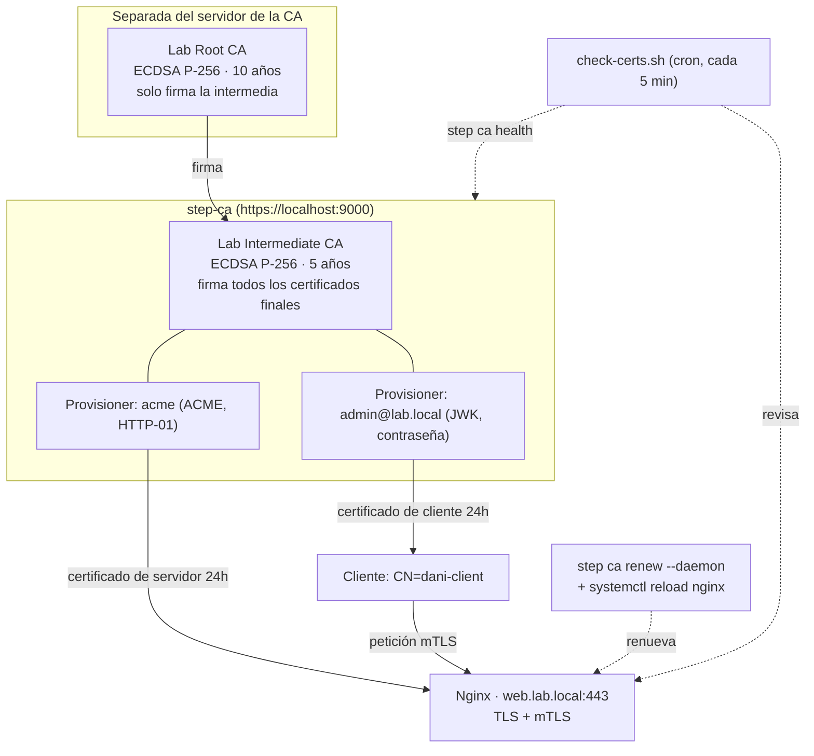

**Cadena de confianza:** `web.lab.local` / `dani-client` → `Lab Intermediate CA` → `Lab Root CA`.

## 4. Entorno del lab

| Elemento | Valor |
|---|---|
| Equipo | VM de Kali Linux en VMware (gratis) |
| Software de CA | `step` CLI 0.31.0, `step-ca` 0.30.2 (Smallstep, código abierto) |
| Servidor web | Nginx (paquete de Kali) |
| Tipo de clave | ECDSA P-256 en todas las claves |
| Dirección de la CA | `https://localhost:9000` |
| Nombre de prueba | `web.lab.local` → `127.0.0.1` (en `/etc/hosts`) |
| Costo | $0 |

---

## 5. Paso a paso

Cada comando es el que ejecuté realmente, seguido de lo que hace. Las capturas están en [`docs/evidence/`](docs/evidence/).

### Paso 1 — Instalar las herramientas

Kali solo trae las *librerías* de Go de Smallstep (paquetes `-dev`), no los programas, así que instalé los paquetes `.deb` oficiales.

```bash
cd /tmp
wget https://dl.smallstep.com/cli/docs-cli-install/latest/step-cli_amd64.deb
sudo dpkg -i step-cli_amd64.deb
wget https://dl.smallstep.com/certificates/docs-ca-install/latest/step-ca_amd64.deb
sudo dpkg -i step-ca_amd64.deb
step version
step-ca version
```

| Comando | Qué hace |
|---|---|
| `wget <url>` | Descarga el paquete instalador. |
| `sudo dpkg -i <archivo>.deb` | Instala el paquete (requiere permisos de administrador). |
| `step version` / `step-ca version` | Confirma que ambas herramientas quedaron instaladas. `step` es la línea de comandos para claves y certificados; `step-ca` es el servidor de la CA. |

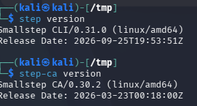

### Paso 2 — Construir la PKI de dos niveles (raíz + intermedia)

Construí la jerarquía **a mano**, en vez de dejar que un asistente lo hiciera, para controlar cada parámetro.

```bash
mkdir -p ~/pki-lab/root ~/pki-lab/intermediate
chmod 700 ~/pki-lab/root ~/pki-lab/intermediate
cd ~/pki-lab

step certificate create "Lab Root CA" root/root_ca.crt root/root_ca.key \
  --profile root-ca --not-after 87600h

step certificate create "Lab Intermediate CA" intermediate/intermediate_ca.crt intermediate/intermediate_ca.key \
  --profile intermediate-ca --ca root/root_ca.crt --ca-key root/root_ca.key \
  --not-after 43800h

openssl pkey -in ~/pki-lab/intermediate/intermediate_ca.key -noout
step certificate verify intermediate/intermediate_ca.crt --roots root/root_ca.crt
step certificate inspect intermediate/intermediate_ca.crt --short
```

| Comando / opción | Qué hace |
|---|---|
| `chmod 700` | Solo mi usuario puede abrir las carpetas con claves privadas. |
| `step certificate create "<nombre>" <crt> <key>` | Genera un par de claves y un certificado. El `.crt` es público; el `.key` es secreto y queda **cifrado con contraseña**. |
| `--profile root-ca` | Certificado de CA autofirmado con las extensiones correctas (CA:TRUE). |
| `--profile intermediate-ca --ca … --ca-key …` | CA intermedia **firmada por la raíz**. |
| `--not-after 87600h` / `43800h` | Vida útil: 10 años (raíz) y 5 años (intermedia). |
| `openssl pkey -in <key> -noout` | Abre la clave cifrada: si no imprime nada, la contraseña guardada es correcta. |
| `step certificate verify … --roots …` | Valida la cadena intermedia → raíz. Sin salida significa válida. |
| `step certificate inspect … --short` | Muestra Subject, Issuer, tipo de clave y vigencia. |

**Cómo leer el certificado:** *Subject* es a quién pertenece (`Lab Intermediate CA`); *Issuer* es quién lo firmó (`Lab Root CA`).

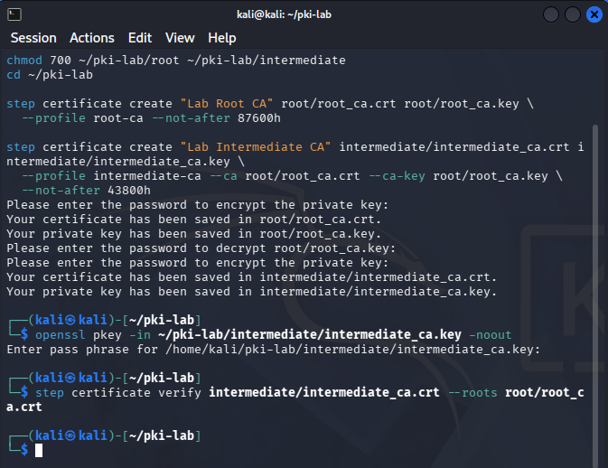

### Paso 3 — Inicializar step-ca y cargar mi propia PKI

`step ca init` genera una configuración funcional, pero también su *propia* raíz e intermedia de ejemplo. Siguiendo el método de Smallstep para usar una PKI existente, generé la configuración base y luego reemplacé la PKI de ejemplo por la mía.

```bash
step ca init --name "Lab CA" --dns localhost --address ":9000" --provisioner admin@lab.local
# Tipo de despliegue: Standalone (corre en local, gratis)
ls -R ~/.step

cp ~/pki-lab/root/root_ca.crt ~/.step/certs/root_ca.crt
cp ~/pki-lab/intermediate/intermediate_ca.crt ~/.step/certs/intermediate_ca.crt
cp ~/pki-lab/intermediate/intermediate_ca.key ~/.step/secrets/intermediate_ca_key
chmod 600 ~/.step/secrets/intermediate_ca_key
shred -u ~/.step/secrets/root_ca_key

fp=$(step certificate fingerprint ~/.step/certs/root_ca.crt)
sed -i "s/\"fingerprint\": \"[^\"]*\"/\"fingerprint\": \"$fp\"/" ~/.step/config/defaults.json
cat ~/.step/config/defaults.json
```

| Comando | Qué hace |
|---|---|
| `step ca init … --provisioner admin@lab.local` | Crea `~/.step` (configuración, certificados, secretos) y un **provisioner JWK** (una identidad con contraseña autorizada a pedir certificados). |
| `cp …` | Reemplaza la raíz e intermedia de ejemplo por **mi** raíz, mi intermedia y la clave de mi intermedia. |
| `chmod 600` | Clave de la intermedia legible solo por mi usuario. |
| `shred -u ~/.step/secrets/root_ca_key` | Sobrescribe y borra la clave raíz de ejemplo. **step-ca nunca necesita la clave raíz**; mi clave raíz real queda fuera del directorio de la CA. |
| `step certificate fingerprint` | Huella SHA-256 de mi raíz (valor público con el que los clientes fijan la CA). |
| `sed -i …` | Escribe la huella de mi raíz en `defaults.json` para que la CLI confíe en la CA correcta. |

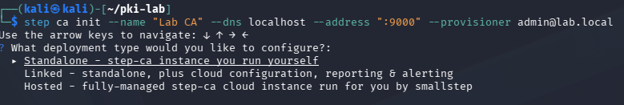
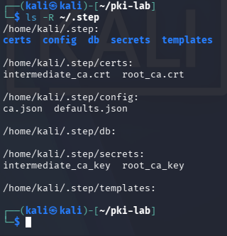
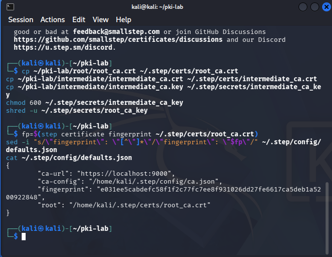

### Paso 4 — Arrancar la CA

```bash
step ca provisioner add acme --type ACME     # (ver Paso 6)
step-ca ~/.step/config/ca.json               # terminal 1, pide la contraseña de la intermedia
step ca health                               # terminal 2 → ok
```

| Comando | Qué hace |
|---|---|
| `step-ca <ca.json>` | Arranca el servidor de la CA en el puerto 9000. Desbloquea la clave de la intermedia con su contraseña. |
| `step ca health` | Pregunta a la CA si está viva, usando la URL y la huella de `defaults.json`. El `ok` también confirma que la huella es correcta. |

### Paso 5 — Primer certificado (24 horas)

```bash
mkdir -p ~/pki-lab/leaf && cd ~/pki-lab/leaf
step ca certificate localhost localhost.crt localhost.key
step certificate inspect localhost.crt --short
step certificate verify localhost.crt --roots ~/pki-lab/root/root_ca.crt
```

| Comando | Qué hace |
|---|---|
| `step ca certificate <nombre> <crt> <key>` | Pide un certificado a mi CA, autenticándose con la contraseña del provisioner JWK. |
| `inspect --short` | Muestra el resultado: Subject `localhost`, Issuer `Lab Intermediate CA`, **válido por 24 horas** (valor por defecto de step-ca). |

Las horas del certificado están en UTC (`Z`); Costa Rica es UTC-6. step-ca adelanta el inicio ~1 minuto para tolerar relojes desajustados.

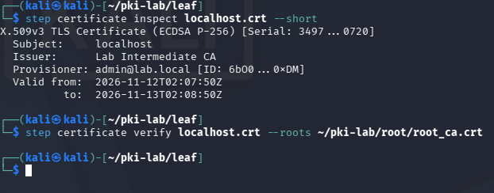
*(Esta captura es de mi primera construcción, el 11 de noviembre; después reconstruí la PKI — ver [Lecciones aprendidas](#8-problemas-y-lecciones-aprendidas).)*

### Paso 6 — ACME: emisión automática con HTTP-01

ACME permite que un programa obtenga certificados **sin contraseñas**. La CA plantea un **reto**: con HTTP-01, el cliente debe publicar un token aleatorio en `http://<nombre>/.well-known/acme-challenge/…` en el puerto 80, y la CA lo consulta para confirmar que el cliente controla ese nombre.

```bash
step ca provisioner add acme --type ACME
curl --cacert ~/pki-lab/root/root_ca.crt https://localhost:9000/acme/acme/directory

echo "127.0.0.1 web.lab.local" | sudo tee -a /etc/hosts
mkdir -p ~/pki-lab/acme && cd ~/pki-lab/acme
sudo env STEPPATH=$HOME/.step step ca certificate web.lab.local web.crt web.key --provisioner acme
sudo chown $USER:$USER web.crt web.key
step certificate inspect web.crt --short
```

| Comando | Qué hace |
|---|---|
| `step ca provisioner add acme --type ACME` | Agrega a `ca.json` un provisioner ACME llamado `acme`. Su URL de directorio es `/acme/<nombre-del-provisioner>/directory`. |
| `curl --cacert <raíz> …/directory` | Obtiene el directorio ACME (`newNonce`, `newAccount`, `newOrder`…). `--cacert` hace que curl confíe en mi raíz. |
| `tee -a /etc/hosts` | Asocia el nombre de prueba `web.lab.local` a esta máquina, para que la CA pueda llegar al reto. |
| `sudo env STEPPATH=… step ca certificate … --provisioner acme` | `step` actúa como cliente ACME y abre un servidor web temporal en el **puerto 80** (requiere `sudo`). `STEPPATH` mantiene mi configuración en vez de la de root. |
| `chown` | Devuelve los archivos a mi usuario. |

Resultado: **Provisioner `acme`**, Subject `web.lab.local`, vigencia de 24 horas. Lo emitió un programa, no una persona con contraseña.

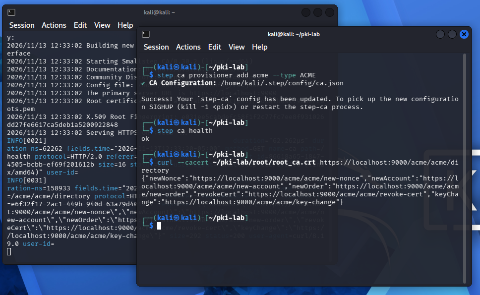
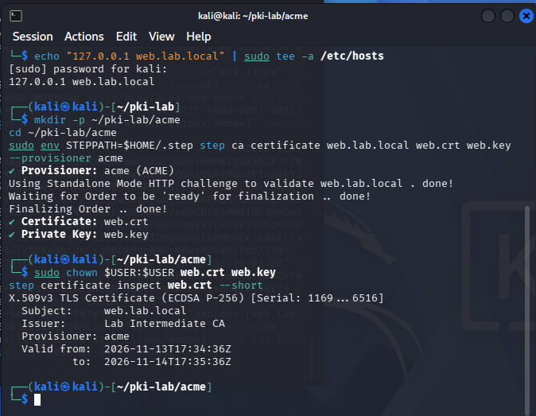

### Paso 7 — Renovación manual

```bash
step ca renew --force web.crt web.key
step certificate inspect web.crt --short
```

| Comando | Qué hace |
|---|---|
| `step ca renew --force` | Renueva **usando el certificado actual, todavía válido, como autenticación (mTLS)**: sin contraseña y sin reto. `--force` renueva aunque todavía no toque. |

Qué cambió: nuevo **serial** y una nueva ventana de 24 horas. Subject, Issuer y Provisioner se mantuvieron.
**Punto clave:** la renovación solo funciona mientras el certificado sigue vigente; uno expirado hay que emitirlo de nuevo desde cero (ACME).

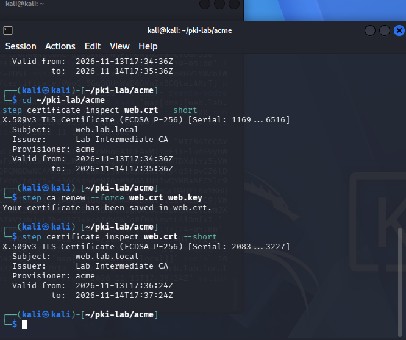

### Paso 8 — Usar el certificado en Nginx (HTTPS)

```bash
sudo apt update && sudo apt install -y nginx
sudo mkdir -p /etc/nginx/certs
sudo cp ~/pki-lab/acme/web.crt ~/pki-lab/acme/web.key /etc/nginx/certs/
sudo chmod 600 /etc/nginx/certs/web.key
# configuración: ver config/nginx/web.conf (primera versión sin las líneas de mTLS)
sudo nginx -t
sudo systemctl restart nginx

curl --cacert ~/pki-lab/root/root_ca.crt https://web.lab.local   # PKI lab OK
curl https://web.lab.local                                       # error 60
```

| Comando | Qué hace |
|---|---|
| `apt update` | Refresca la lista de paquetes (resolvió un `404 Not Found` por un índice desactualizado). |
| `chmod 600 web.key` | Clave privada legible solo por root (el proceso principal de Nginx la lee al arrancar). |
| `nginx -t` | Valida la configuración antes de aplicarla. |
| `curl` **con** `--cacert` | Funciona: curl valida `web.lab.local` → intermedia → **mi raíz**. |
| `curl` **sin** `--cacert` | Falla con *error 60: unable to get local issuer certificate*, porque Kali solo confía en raíces públicas. **Es el comportamiento esperado de una PKI privada.** |

Después instalé mi raíz en el almacén de confianza del sistema, lo mismo que hacen las empresas por GPO o MDM:

```bash
sudo cp ~/pki-lab/root/root_ca.crt /usr/local/share/ca-certificates/lab-root-ca.crt
sudo update-ca-certificates
curl https://web.lab.local    # PKI lab OK, ya sin --cacert
```

> Instalar una raíz significa que el equipo confiará en **todo** lo que esa raíz firme. Solo se hace con raíces propias y controladas.

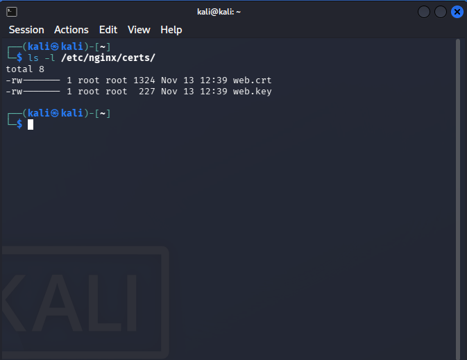
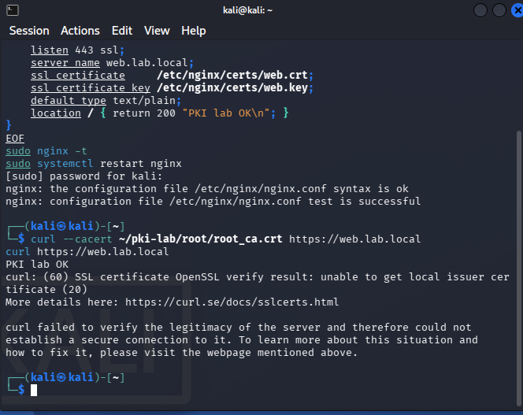
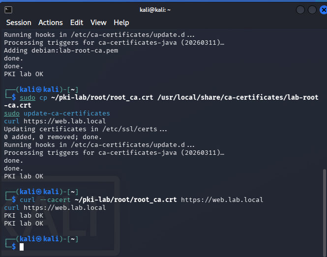

### Paso 9 — TLS mutuo (mTLS)

Con mTLS el servidor también exige un certificado **al cliente**. Sin un certificado válido de mi CA, no hay acceso. Así se protege el tráfico entre servicios sin contraseñas.

```bash
mkdir -p ~/pki-lab/client && cd ~/pki-lab/client
step ca certificate dani-client client.crt client.key --provisioner admin@lab.local

cat ~/pki-lab/intermediate/intermediate_ca.crt ~/pki-lab/root/root_ca.crt \
  | sudo tee /etc/nginx/certs/ca-bundle.crt > /dev/null
# configuración: config/nginx/web.conf (agrega ssl_client_certificate / ssl_verify_client / ssl_verify_depth)
sudo nginx -t && sudo systemctl reload nginx

curl https://web.lab.local                                                    # 400 No required SSL certificate was sent
curl --cert ~/pki-lab/client/client.crt --key ~/pki-lab/client/client.key https://web.lab.local
# PKI lab OK, cliente: CN=dani-client
```

| Directiva / comando | Qué hace |
|---|---|
| `step ca certificate dani-client …` | Certificado de cliente para la identidad `dani-client` (los certificados de step-ca incluyen el uso *clientAuth*). |
| `ca-bundle.crt` | Intermedia + raíz: las CAs que Nginx acepta para clientes. |
| `ssl_client_certificate` | En qué CAs confía Nginx para certificados de cliente. |
| `ssl_verify_client on` | El certificado de cliente es **obligatorio**. |
| `ssl_verify_depth 2` | Permite la cadena cliente → intermedia → raíz. |
| `$ssl_client_s_dn` | Nginx muestra en la respuesta la identidad verificada del cliente. |

**Resultado:** sin certificado de cliente → `400 No required SSL certificate was sent`; con él → `PKI lab OK, cliente: CN=dani-client`.

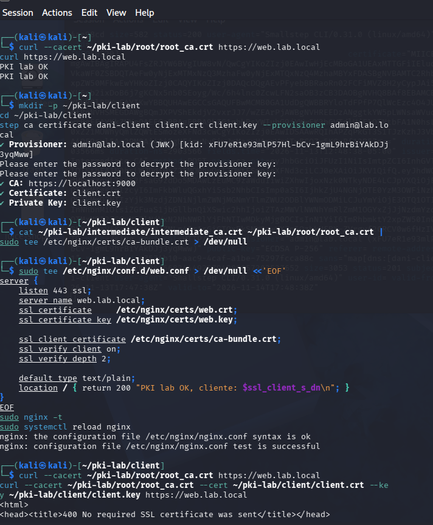
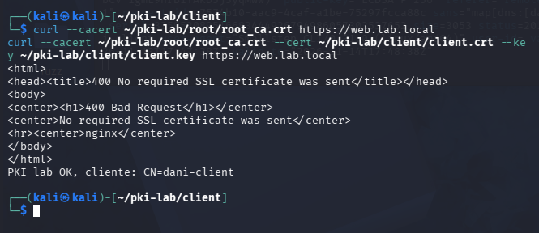

### Paso 10 — Renovación automática

```bash
# ¿Qué certificado está sirviendo Nginx ahora?
echo | openssl s_client -connect web.lab.local:443 -servername web.lab.local 2>/dev/null \
  | openssl x509 -noout -serial -enddate

# Renovar + recargar, y revisar de nuevo (serial y notAfter nuevos)
sudo env STEPPATH=$HOME/.step step ca renew --force /etc/nginx/certs/web.crt /etc/nginx/certs/web.key
sudo systemctl reload nginx

# Automatizarlo
sudo env STEPPATH=$HOME/.step step ca renew --daemon --exec "systemctl reload nginx" \
  /etc/nginx/certs/web.crt /etc/nginx/certs/web.key
```

| Comando | Qué hace |
|---|---|
| `openssl s_client … \| openssl x509 -serial -enddate` | Muestra el certificado que Nginx **sirve realmente** (serial y expiración). |
| `systemctl reload nginx` | Nginx solo lee los certificados al arrancar o recargar. Sin esto, sigue sirviendo el viejo. |
| `step ca renew --daemon --exec "…"` | Se queda corriendo, renueva **antes** de que expire (programó la primera renovación en ~15h27m, cerca de 2/3 de las 24 horas) y recarga Nginx tras cada renovación. |

Antes → después: serial `…C89B` → `…1ED2D8`, expiración `17:37:24` → `17:53:30` GMT.

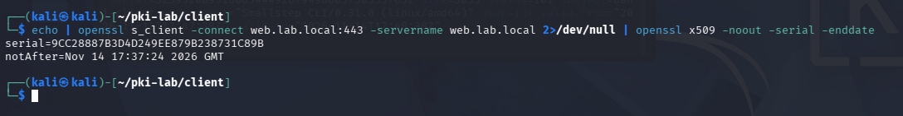
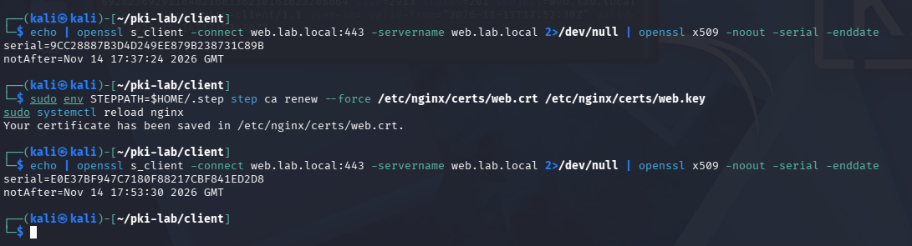
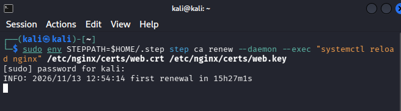

### Paso 11 — Simulacro de caída de la CA

Apagué la CA (`Ctrl+C`) y observé:

```bash
sudo env STEPPATH=$HOME/.step step ca renew --force /etc/nginx/certs/web.crt /etc/nginx/certs/web.key
# error renewing certificate: ... connect: connection refused
curl --cert ~/pki-lab/client/client.crt --key ~/pki-lab/client/client.key https://web.lab.local
# PKI lab OK, cliente: CN=dani-client   ← el servicio sigue arriba
step-ca ~/.step/config/ca.json   # al reiniciar la CA, la renovación vuelve a funcionar
```

**Hallazgos**

- La CA **no** participa en cada conexión TLS: Nginx presenta el certificado que ya cargó y el cliente lo valida con la raíz en la que ya confía. Por eso el servicio siguió funcionando.
- El servicio aguanta hasta que el certificado **expira** (24 horas después de emitido). El daemon intenta renovar a las ~15 horas, lo que deja **~9 horas** para arreglar la CA.
- El riesgo real es que la falla es **silenciosa**: hoy todo funciona y mañana el servicio se cae de golpe. → Hace falta monitoreo.

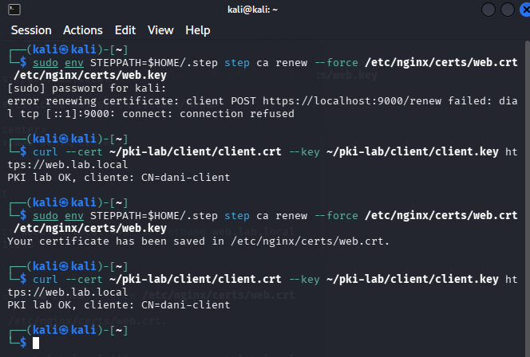

### Paso 12 — Monitoreo y alertas

Escribí [`scripts/check-certs.sh`](scripts/check-certs.sh):

| Línea | Qué hace |
|---|---|
| `openssl x509 -checkend 28800 -noout -in "$CERT"` | Tiene éxito si el certificado **no** expira en 28800 s (8 h). |
| `step ca health > /dev/null 2>&1` | Tiene éxito si la CA responde; oculta la salida, solo importa el resultado. |
| `if …; then … else … fi` | Dos revisiones **independientes**; cada una imprime `OK` o `ALERTA` con fecha y hora. |
| `ESTADO=1` / `exit $ESTADO` | Código de salida 0 = sano, 1 = alerta. Lo puede usar cron, systemd o un sistema de monitoreo. |

Pruebas: CA encendida → dos `OK` y código de salida `0`; CA apagada → `ALERTA: la CA no responde` y código `1`; umbral subido a 25 horas → `ALERTA` del certificado.

Programado en el crontab de root ([`config/cron/pki-lab-check.cron`](config/cron/pki-lab-check.cron)):

```cron
STEPPATH=/home/kali/.step
*/5 * * * * /home/kali/pki-lab/check-certs.sh >> /var/log/pki-lab-check.log 2>&1
```

| Parte | Significado |
|---|---|
| `STEPPATH=…` | Para que `step` (corriendo como root) encuentre la configuración de mi CA; si no, la revisión de la CA siempre fallaría. |
| `*/5 * * * *` | Cada 5 minutos. |
| `>> /var/log/pki-lab-check.log 2>&1` | Agrega la salida y los errores a un archivo de registro. |

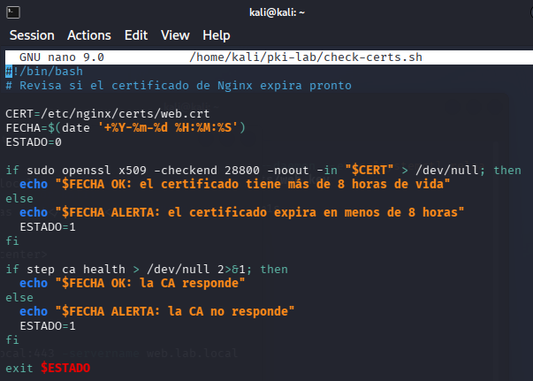
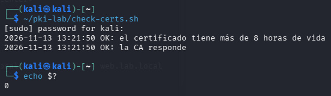
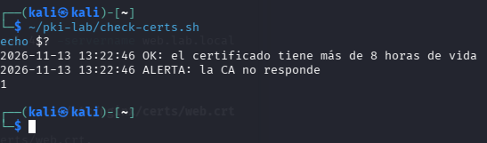
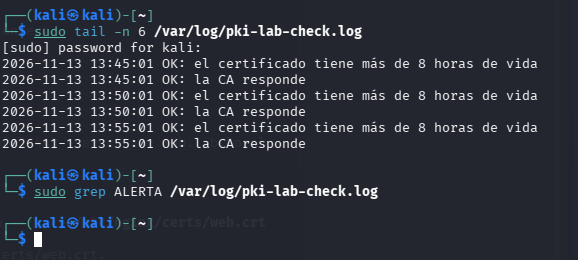

---

## 6. Decisiones de diseño

| Decisión | Por qué |
|---|---|
| **Dos niveles** (raíz + intermedia) | Si la intermedia se compromete, la revoco y emito otra; la raíz y el almacén de confianza de cada equipo siguen intactos. |
| Raíz de **10 años**, intermedia de **5 años** | La raíz está instalada en cada almacén de confianza, así que reemplazarla es costoso, y casi no se usa. La intermedia trabaja a diario, está más expuesta y se puede rotar sin tocar a los clientes. Una intermedia nunca puede vivir más que su raíz. |
| **Sin la clave raíz en el servidor de la CA** | `step-ca` solo necesita la clave de la intermedia. Con la clave raíz robada, un atacante podría crear cualquier certificado y todos los equipos lo aceptarían. |
| **ECDSA P-256** | Claves modernas, pequeñas y rápidas, con amplio soporte. |
| **Certificados finales de 24 horas** | Una clave robada sirve horas, no años (*revocación pasiva*). Obliga a automatizar, en la misma dirección en que el CA/B Forum lleva a los certificados públicos. |
| **ACME** para servidores | Protocolo estándar (RFC 8555), sin contraseñas compartidas, compatible con certbot, acme.sh y Caddy. |
| **mTLS** para clientes | Identidad fuerte entre servicios, sin contraseñas. |
| **Monitoreo con códigos de salida** | Las fallas silenciosas se vuelven visibles y se integran fácilmente con cualquier sistema de alertas. |

**Revocar a un cliente:** revocar en la CA no basta por sí solo, porque Nginx no le pregunta a la CA en cada conexión. Opciones: *revocación activa* (la CRL de step-ca + `ssl_crl` en Nginx) para bloquear de inmediato, o *revocación pasiva* (dejar de renovar; un certificado de 24 horas muere en pocas horas).

## 7. Notas de seguridad

- **Este repositorio no contiene claves privadas, contraseñas ni secretos de la CA.** El `.gitignore` bloquea `*.key`, `*_key`, `secrets/`, `.step/` y `ca.json` (que contiene la clave cifrada del provisioner).
- Los certificados, huellas y seriales que aparecen en las capturas son datos públicos.
- **Limitación del lab (con honestidad):** la clave raíz está en la misma VM, cifrada y fuera del directorio de la CA. En producción estaría offline (HSM, YubiKey o un equipo aislado) y solo se usaría para firmar o rotar intermedias.
- Las contraseñas de las claves se guardan en un gestor de contraseñas; nunca se escriben en comandos ni se comparten.

## 8. Problemas y lecciones aprendidas

| Problema | Qué aprendí |
|---|---|
| Olvidé las contraseñas de las claves después del primer día | Las contraseñas de claves cifradas **no se pueden recuperar**, por diseño. Reconstruí toda la PKI (13 de noviembre), esta vez guardando las contraseñas en un gestor **antes** de usarlas y probándolas con `openssl pkey`. |
| `apt install` falló con `404 Not Found` | Kali es *rolling*; el índice local de paquetes estaba desactualizado → primero `apt update`. |
| La primera versión del monitor mezclaba las dos revisiones en un solo `if` | Cada revisión necesita su propio `if … fi`; si no, la revisión de la CA solo corría cuando el certificado estaba bien, y las alertas salían con la etiqueta equivocada. |
| ACME necesita el puerto 80 | Escuchar en puertos menores a 1024 requiere root → `sudo env STEPPATH=…` para mantener mi configuración. |
| Se renovó el archivo, pero Nginx seguía sirviendo el certificado viejo | Nginx lee los certificados solo al arrancar o recargar → `--exec "systemctl reload nginx"`. |
| Confusión entre Subject e Issuer | Subject es el dueño del certificado; Issuer es quien lo firmó. |

## 9. Próximos pasos

- [ ] Correr `step-ca` y el renovador como **servicios de systemd** (archivo de contraseña con permisos `600`) en vez de terminales.
- [ ] **Revocación activa**: CRL de step-ca + `ssl_crl` en Nginx; probar revocando a `dani-client`.
- [ ] El mismo flujo para **Apache** y **Tomcat** (almacenes PKCS#12/JKS).
- [ ] Panel de **Prometheus + Grafana** con días restantes y disponibilidad de la CA, con reglas de alerta.
- [ ] Clave de la intermedia en una **YubiKey (PIV)**.
- [ ] Ansible/IaC para reconstruir todo el lab desde cero.

## 10. Estructura del repositorio

```
private-pki-lab/
├── README.md                     # write-up en inglés
├── README.es.md                  # este write-up (español)
├── scripts/check-certs.sh        # monitor de expiración y salud de la CA
├── config/nginx/web.conf         # configuración de Nginx con TLS + mTLS
├── config/cron/pki-lab-check.cron# programación del monitor
├── docs/evidence/                # capturas (01–22)
└── .gitignore                    # bloquea claves y secretos de la CA
```

---

**Referencias:** [Documentación de step-ca](https://smallstep.com/docs/step-ca/) · [Usar step-ca con una PKI existente](https://smallstep.com/docs/tutorials/intermediate-ca-new-ca) · [ACME basics](https://smallstep.com/docs/step-ca/acme-basics/) · [Renovación de certificados](https://smallstep.com/docs/step-ca/renewal) · [Consideraciones de producción](https://smallstep.com/docs/step-ca/certificate-authority-server-production/)
