# Private PKI as Code: step-ca, ACME, mTLS and 24-hour certificates

**🇪🇸 [Leer en español](README.es.md)**

A hands-on lab where I built my own **two-tier private Certificate Authority** on a Kali Linux VM with [Smallstep `step-ca`](https://smallstep.com/docs/step-ca/), issued **short-lived (24-hour) certificates** automatically over **ACME**, protected an Nginx service with **mutual TLS (mTLS)**, automated **renewal**, ran a **CA-outage failure drill**, and added **expiry/health monitoring** with alerts.

> Built by Daniel Rocha (Nov 2026) — Senior Technical Support Engineer (SSL/TLS & PKI) moving into Security Engineering.
> Everything here runs locally and free of charge (VMware + Kali Linux, open-source tools).

---

## Table of contents

1. [Why this project](#1-why-this-project)
2. [Results at a glance](#2-results-at-a-glance)
3. [Architecture](#3-architecture)
4. [Lab environment](#4-lab-environment)
5. [Step by step (commands explained + evidence)](#5-step-by-step)
6. [Design decisions](#6-design-decisions)
7. [Security notes](#7-security-notes)
8. [Problems I hit and lessons learned](#8-problems-i-hit-and-lessons-learned)
9. [Repository structure](#9-repository-structure)

---

## 1. Why this project

Public TLS certificates are getting shorter: the CA/Browser Forum approved a schedule (Ballot SC-081) that reduces maximum certificate lifetimes step by step down to **47 days**. Organizations that still renew certificates by hand will break things. The answer is **automation**: short-lived certificates, issued and renewed by machines, with monitoring.

I work with public PKI every day, so I wanted to prove I can **design and operate a PKI end to end**, not just support one:

- Build the hierarchy (root + intermediate) and understand *why* it is built that way.
- Run my own CA and issue certificates automatically with the same protocol Let's Encrypt uses (ACME).
- Use those certificates in a real web server, including **mTLS** (client authentication without passwords).
- Make renewal automatic and **test what happens when the CA goes down**.
- Monitor expiry and CA health so failures are not silent.

## 2. Results at a glance

| Capability | Status | Proof |
|---|---|---|
| Two-tier PKI (ECDSA P-256 root 10y + intermediate 5y) | ✅ | [Evidence 02](#step-2--build-the-two-tier-pki-root--intermediate) |
| `step-ca` running with **my own** root/intermediate (no root key on the CA) | ✅ | [Evidence 05–06](#step-3--initialize-step-ca-and-load-my-own-pki) |
| 24-hour certificates | ✅ | [Evidence 07–08](#step-5--first-certificate-24-hours) |
| ACME (HTTP-01) issuance, no passwords | ✅ | [Evidence 08](#step-6--acme-automatic-issuance-with-http-01) |
| Nginx HTTPS with private CA + trust store | ✅ | [Evidence 11–12](#step-8--use-the-certificate-in-nginx-https) |
| **mTLS**: reject without client cert, accept with it | ✅ | [Evidence 14](#step-9--mutual-tls-mtls) |
| Automated renewal + Nginx reload | ✅ | [Evidence 15–17](#step-10--automated-renewal) |
| CA-outage failure drill | ✅ | [Evidence 18](#step-11--ca-outage-failure-drill) |
| Expiry + CA health monitoring every 5 min | ✅ | [Evidence 20–22](#step-12--monitoring-and-alerts) |

## 3. Architecture

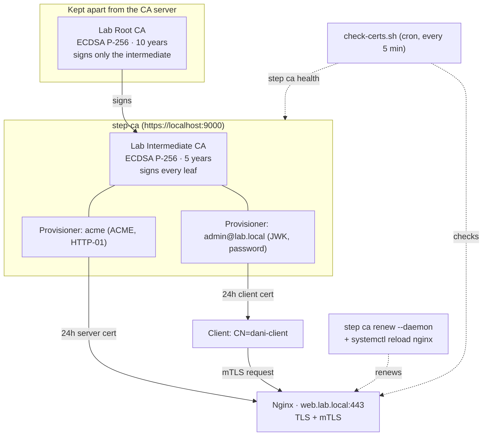

**Chain of trust:** `web.lab.local` / `dani-client` → `Lab Intermediate CA` → `Lab Root CA`.

## 4. Lab environment

| Item | Value |
|---|---|
| Host | Kali Linux VM on VMware (free) |
| CA software | `step` CLI 0.31.0, `step-ca` 0.30.2 (Smallstep, open source) |
| Web server | Nginx (Kali package) |
| Key type | ECDSA P-256 for every key |
| CA address | `https://localhost:9000` |
| Test hostname | `web.lab.local` → `127.0.0.1` (via `/etc/hosts`) |
| Cost | $0 |

---

## 5. Step by step

Every command below is the one I actually ran, followed by what it does. Screenshots are in [`docs/evidence/`](docs/evidence/).

### Step 1 — Install the tools

Kali only ships the Go *libraries* for Smallstep (`-dev` packages), not the programs, so I installed the official `.deb` packages.

```bash
cd /tmp
wget https://dl.smallstep.com/cli/docs-cli-install/latest/step-cli_amd64.deb
sudo dpkg -i step-cli_amd64.deb
wget https://dl.smallstep.com/certificates/docs-ca-install/latest/step-ca_amd64.deb
sudo dpkg -i step-ca_amd64.deb
step version
step-ca version
```

| Command | What it does |
|---|---|
| `wget <url>` | Downloads the installer package. |
| `sudo dpkg -i <file>.deb` | Installs the package (needs admin rights). |
| `step version` / `step-ca version` | Confirms both tools are installed. `step` is the CLI for keys/certificates; `step-ca` is the CA server. |

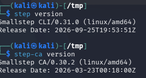

### Step 2 — Build the two-tier PKI (root + intermediate)

I built the hierarchy **by hand** instead of letting a wizard do it, to control every parameter.

```bash
mkdir -p ~/pki-lab/root ~/pki-lab/intermediate
chmod 700 ~/pki-lab/root ~/pki-lab/intermediate
cd ~/pki-lab

step certificate create "Lab Root CA" root/root_ca.crt root/root_ca.key \
  --profile root-ca --not-after 87600h

step certificate create "Lab Intermediate CA" intermediate/intermediate_ca.crt intermediate/intermediate_ca.key \
  --profile intermediate-ca --ca root/root_ca.crt --ca-key root/root_ca.key \
  --not-after 43800h

openssl pkey -in ~/pki-lab/intermediate/intermediate_ca.key -noout
step certificate verify intermediate/intermediate_ca.crt --roots root/root_ca.crt
step certificate inspect intermediate/intermediate_ca.crt --short
```

| Command / flag | What it does |
|---|---|
| `chmod 700` | Only my user can open the folders that hold private keys. |
| `step certificate create "<name>" <crt> <key>` | Generates a key pair and a certificate. The `.crt` is public; the `.key` is secret and is **encrypted with a password**. |
| `--profile root-ca` | Self-signed CA certificate with the right extensions (CA:TRUE). |
| `--profile intermediate-ca --ca … --ca-key …` | Intermediate CA **signed by the root**. |
| `--not-after 87600h` / `43800h` | Lifetime: 10 years (root) and 5 years (intermediate). |
| `openssl pkey -in <key> -noout` | Opens the encrypted key: no output = the password I saved is correct. |
| `step certificate verify … --roots …` | Validates the chain intermediate → root. No output = valid. |
| `step certificate inspect … --short` | Shows Subject, Issuer, key type and validity. |

**Reading the certificate:** *Subject* = who the certificate belongs to (`Lab Intermediate CA`); *Issuer* = who signed it (`Lab Root CA`).

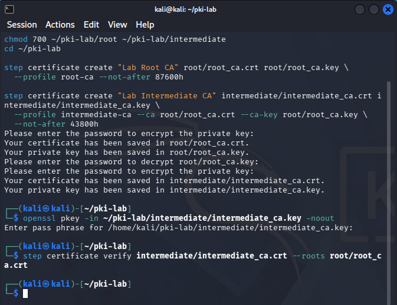

### Step 3 — Initialize step-ca and load my own PKI

`step ca init` generates a working configuration but also its *own* sample root and intermediate. Following Smallstep's "use your existing PKI" method, I generated the boilerplate and then replaced the sample PKI with mine.

```bash
step ca init --name "Lab CA" --dns localhost --address ":9000" --provisioner admin@lab.local
# Deployment type: Standalone (runs locally, free)
ls -R ~/.step

cp ~/pki-lab/root/root_ca.crt ~/.step/certs/root_ca.crt
cp ~/pki-lab/intermediate/intermediate_ca.crt ~/.step/certs/intermediate_ca.crt
cp ~/pki-lab/intermediate/intermediate_ca.key ~/.step/secrets/intermediate_ca_key
chmod 600 ~/.step/secrets/intermediate_ca_key
shred -u ~/.step/secrets/root_ca_key

fp=$(step certificate fingerprint ~/.step/certs/root_ca.crt)
sed -i "s/\"fingerprint\": \"[^\"]*\"/\"fingerprint\": \"$fp\"/" ~/.step/config/defaults.json
cat ~/.step/config/defaults.json
```

| Command | What it does |
|---|---|
| `step ca init … --provisioner admin@lab.local` | Creates `~/.step` (config, certs, secrets) and a **JWK provisioner** (a password-protected identity allowed to request certificates). |
| `cp …` | Replaces the sample root/intermediate with **my** root, intermediate and intermediate key. |
| `chmod 600` | Intermediate key readable only by my user. |
| `shred -u ~/.step/secrets/root_ca_key` | Overwrites and deletes the sample root key. **step-ca never needs the root key**; my real root key stays outside the CA directory. |
| `step certificate fingerprint` | SHA-256 fingerprint of my root (public value clients use to pin the CA). |
| `sed -i …` | Writes my root's fingerprint into `defaults.json` so the CLI trusts the right CA. |

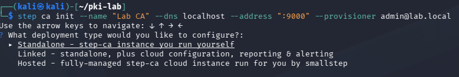
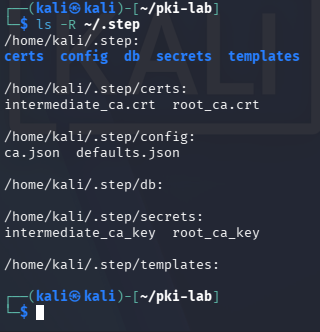
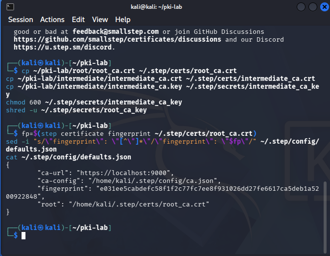

### Step 4 — Start the CA

```bash
step ca provisioner add acme --type ACME     # (see Step 6)
step-ca ~/.step/config/ca.json               # terminal 1, asks for the intermediate key password
step ca health                               # terminal 2 → ok
```

| Command | What it does |
|---|---|
| `step-ca <ca.json>` | Starts the CA server on port 9000. It unlocks the intermediate key with its password. |
| `step ca health` | Asks the CA if it is alive, using the URL and fingerprint in `defaults.json`. `ok` also proves the fingerprint is right. |

### Step 5 — First certificate (24 hours)

```bash
mkdir -p ~/pki-lab/leaf && cd ~/pki-lab/leaf
step ca certificate localhost localhost.crt localhost.key
step certificate inspect localhost.crt --short
step certificate verify localhost.crt --roots ~/pki-lab/root/root_ca.crt
```

| Command | What it does |
|---|---|
| `step ca certificate <name> <crt> <key>` | Requests a certificate from my CA, authenticating with the JWK provisioner password. |
| `inspect --short` | Shows the result: Subject `localhost`, Issuer `Lab Intermediate CA`, **valid for 24 hours** (step-ca default). |

Times in the certificate are UTC (`Z`); Costa Rica is UTC-6. step-ca backdates the start by ~1 minute to tolerate clock skew.

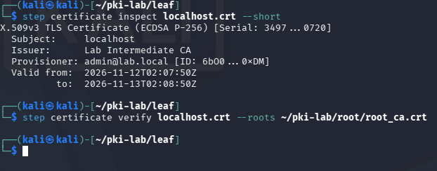
*(This screenshot is from my first build on Nov 11; I later rebuilt the PKI — see [Lessons learned](#8-problems-i-hit-and-lessons-learned).)*

### Step 6 — ACME: automatic issuance with HTTP-01

ACME lets a program obtain certificates **without passwords**. The CA gives a **challenge**: with HTTP-01 the client must publish a random token at `http://<name>/.well-known/acme-challenge/…` on port 80, and the CA fetches it to confirm the client controls that name.

```bash
step ca provisioner add acme --type ACME
curl --cacert ~/pki-lab/root/root_ca.crt https://localhost:9000/acme/acme/directory

echo "127.0.0.1 web.lab.local" | sudo tee -a /etc/hosts
mkdir -p ~/pki-lab/acme && cd ~/pki-lab/acme
sudo env STEPPATH=$HOME/.step step ca certificate web.lab.local web.crt web.key --provisioner acme
sudo chown $USER:$USER web.crt web.key
step certificate inspect web.crt --short
```

| Command | What it does |
|---|---|
| `step ca provisioner add acme --type ACME` | Adds an ACME provisioner named `acme` to `ca.json`. Its directory URL is `/acme/<provisioner-name>/directory`. |
| `curl --cacert <root> …/directory` | Fetches the ACME directory (`newNonce`, `newAccount`, `newOrder`…). `--cacert` makes curl trust my root. |
| `tee -a /etc/hosts` | Maps the test name `web.lab.local` to this machine so the CA can reach the challenge. |
| `sudo env STEPPATH=… step ca certificate … --provisioner acme` | `step` acts as an ACME client and opens a temporary web server on **port 80** (needs `sudo`). `STEPPATH` keeps using my config instead of root's. |
| `chown` | Gives the files back to my user. |

Result: **Provisioner `acme`**, Subject `web.lab.local`, 24-hour validity — issued by a program, not by a person with a password.

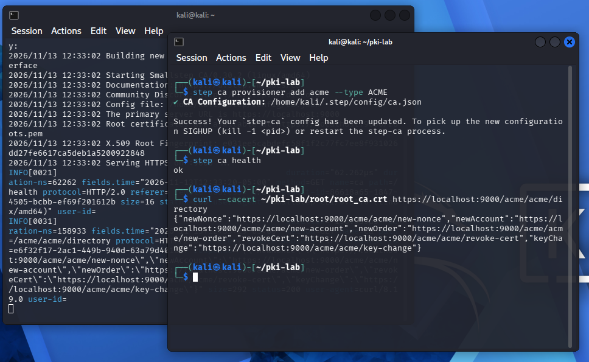
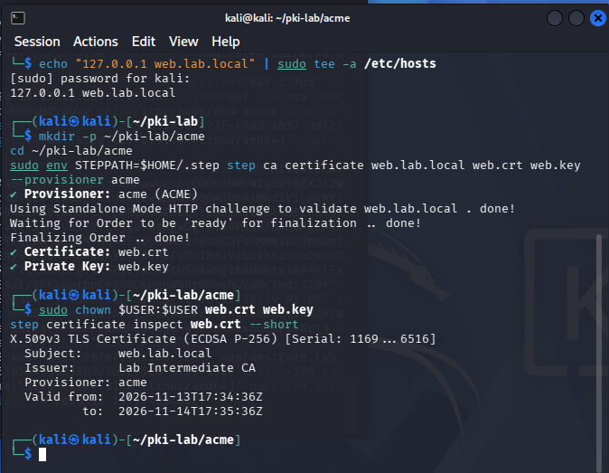

### Step 7 — Manual renewal

```bash
step ca renew --force web.crt web.key
step certificate inspect web.crt --short
```

| Command | What it does |
|---|---|
| `step ca renew --force` | Renews **using the current, still-valid certificate as authentication (mTLS)** — no password, no challenge. `--force` renews even if it is not due yet. |

What changed: new **serial** and a new 24-hour window. Subject, Issuer and Provisioner stayed the same.
**Key point:** renewal only works while the certificate is still valid; an expired certificate must be issued again from scratch (ACME).

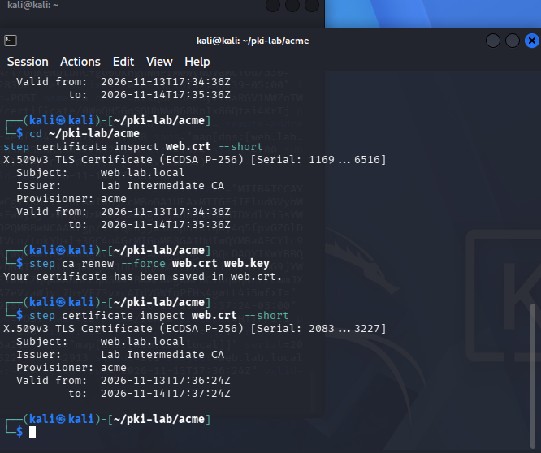

### Step 8 — Use the certificate in Nginx (HTTPS)

```bash
sudo apt update && sudo apt install -y nginx
sudo mkdir -p /etc/nginx/certs
sudo cp ~/pki-lab/acme/web.crt ~/pki-lab/acme/web.key /etc/nginx/certs/
sudo chmod 600 /etc/nginx/certs/web.key
# config: see config/nginx/web.conf (first version without the mTLS lines)
sudo nginx -t
sudo systemctl restart nginx

curl --cacert ~/pki-lab/root/root_ca.crt https://web.lab.local   # PKI lab OK
curl https://web.lab.local                                       # error 60
```

| Command | What it does |
|---|---|
| `apt update` | Refreshes the package list (fixed a `404 Not Found` from a stale index). |
| `chmod 600 web.key` | Private key readable only by root (Nginx's master process reads it at start). |
| `nginx -t` | Validates the config before applying it. |
| `curl` **with** `--cacert` | Works: curl validates `web.lab.local` → intermediate → **my root**. |
| `curl` **without** `--cacert` | Fails with *error 60: unable to get local issuer certificate* — Kali only trusts public roots. **This is the expected behavior of a private PKI.** |

Then I installed my root in the OS trust store, the same thing companies do through GPO/MDM:

```bash
sudo cp ~/pki-lab/root/root_ca.crt /usr/local/share/ca-certificates/lab-root-ca.crt
sudo update-ca-certificates
curl https://web.lab.local    # PKI lab OK, no --cacert needed
```

> Installing a root means the machine will trust **everything** that root signs — only do it with roots you control.

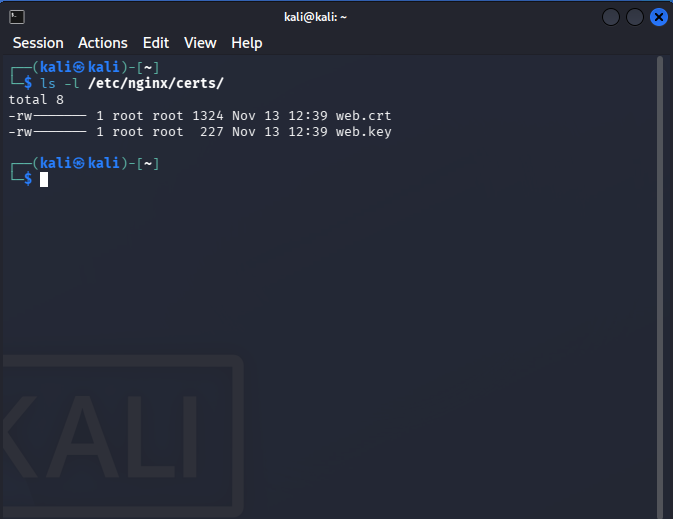
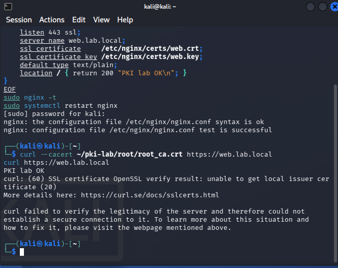
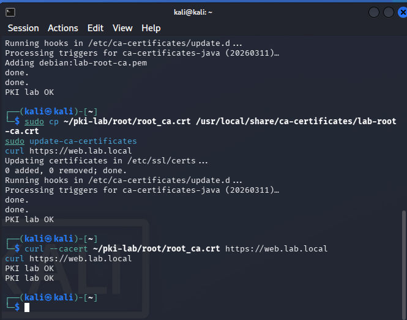

### Step 9 — Mutual TLS (mTLS)

With mTLS the server also demands a certificate **from the client**. No valid certificate from my CA → no access. This is how service-to-service traffic is secured without passwords.

```bash
mkdir -p ~/pki-lab/client && cd ~/pki-lab/client
step ca certificate dani-client client.crt client.key --provisioner admin@lab.local

cat ~/pki-lab/intermediate/intermediate_ca.crt ~/pki-lab/root/root_ca.crt \
  | sudo tee /etc/nginx/certs/ca-bundle.crt > /dev/null
# config: config/nginx/web.conf (adds ssl_client_certificate / ssl_verify_client / ssl_verify_depth)
sudo nginx -t && sudo systemctl reload nginx

curl https://web.lab.local                                                    # 400 No required SSL certificate was sent
curl --cert ~/pki-lab/client/client.crt --key ~/pki-lab/client/client.key https://web.lab.local
# PKI lab OK, cliente: CN=dani-client
```

| Directive / command | What it does |
|---|---|
| `step ca certificate dani-client …` | Client certificate for identity `dani-client` (step-ca leaf certs include the *clientAuth* usage). |
| `ca-bundle.crt` | Intermediate + root: the CAs Nginx accepts for clients. |
| `ssl_client_certificate` | Which CAs Nginx trusts for client certificates. |
| `ssl_verify_client on` | Client certificate is **mandatory**. |
| `ssl_verify_depth 2` | Allows the chain client → intermediate → root. |
| `$ssl_client_s_dn` | Nginx prints the verified client identity in the response. |

**Result:** without a client certificate → `400 No required SSL certificate was sent`; with it → `PKI lab OK, cliente: CN=dani-client`.

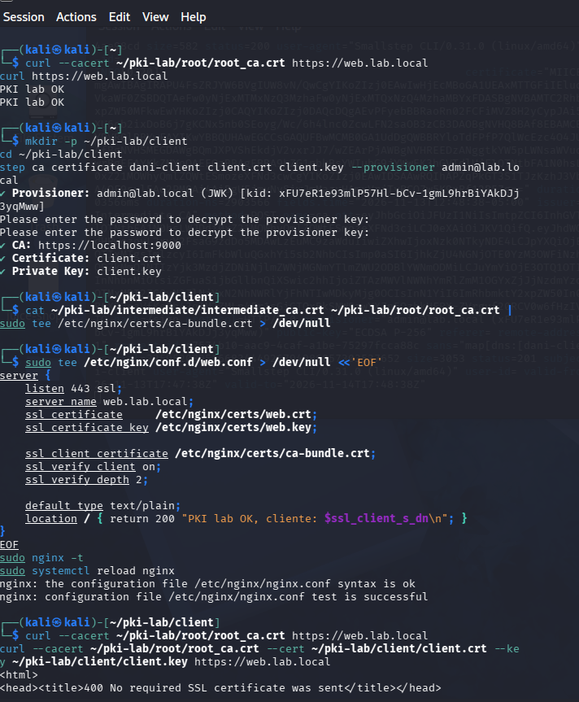
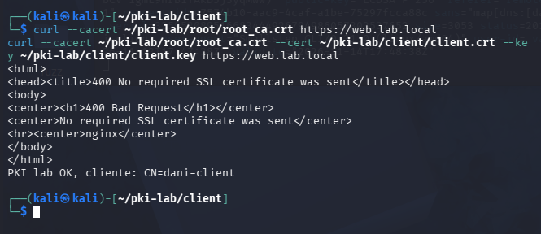

### Step 10 — Automated renewal

```bash
# What is Nginx serving right now?
echo | openssl s_client -connect web.lab.local:443 -servername web.lab.local 2>/dev/null \
  | openssl x509 -noout -serial -enddate

# Renew + reload, then check again (new serial and new notAfter)
sudo env STEPPATH=$HOME/.step step ca renew --force /etc/nginx/certs/web.crt /etc/nginx/certs/web.key
sudo systemctl reload nginx

# Automate it
sudo env STEPPATH=$HOME/.step step ca renew --daemon --exec "systemctl reload nginx" \
  /etc/nginx/certs/web.crt /etc/nginx/certs/web.key
```

| Command | What it does |
|---|---|
| `openssl s_client … \| openssl x509 -serial -enddate` | Shows the certificate **actually served** by Nginx (serial + expiry). |
| `systemctl reload nginx` | Nginx only reads certificates at start/reload — without it, Nginx keeps serving the old one. |
| `step ca renew --daemon --exec "…"` | Stays running, renews **before** expiry (it scheduled the first renewal in ~15h27m, about 2/3 of the 24h lifetime) and reloads Nginx after each renewal. |

Before → after: serial `…C89B` → `…1ED2D8`, expiry `17:37:24` → `17:53:30` GMT.

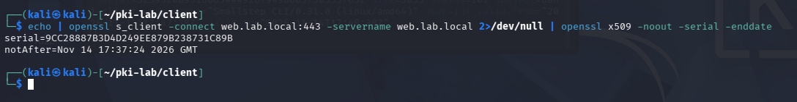
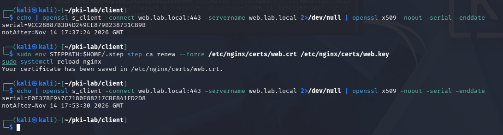
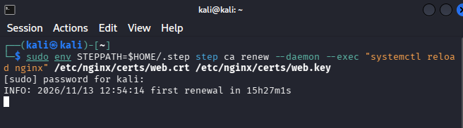

### Step 11 — CA-outage failure drill

I stopped the CA (`Ctrl+C`) and observed:

```bash
sudo env STEPPATH=$HOME/.step step ca renew --force /etc/nginx/certs/web.crt /etc/nginx/certs/web.key
# error renewing certificate: ... connect: connection refused
curl --cert ~/pki-lab/client/client.crt --key ~/pki-lab/client/client.key https://web.lab.local
# PKI lab OK, cliente: CN=dani-client   ← service still up
step-ca ~/.step/config/ca.json   # restart the CA → renewal works again
```

**Findings**

- The CA is **not** involved in each TLS connection: Nginx presents the certificate it already loaded and the client validates it with the root it already trusts. So the service kept working.
- The service survives until the certificate **expires** (24h after issuance). The daemon first tries at ~15h, leaving **~9 hours** to fix the CA.
- The real risk is that the failure is **silent**: everything works today and the service breaks suddenly tomorrow. → Monitoring is required.

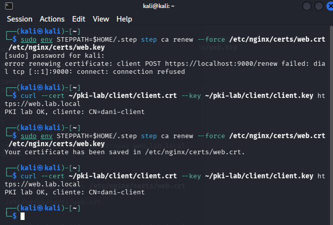

### Step 12 — Monitoring and alerts

I wrote [`scripts/check-certs.sh`](scripts/check-certs.sh):

| Line | What it does |
|---|---|
| `openssl x509 -checkend 28800 -noout -in "$CERT"` | Succeeds if the certificate does **not** expire within 28800 s (8 h). |
| `step ca health > /dev/null 2>&1` | Succeeds if the CA answers; output hidden, only the result matters. |
| `if …; then … else … fi` | Two **independent** checks, each prints `OK` or `ALERTA` with timestamp. |
| `ESTADO=1` / `exit $ESTADO` | Exit code 0 = healthy, 1 = alert — consumable by cron, systemd or a monitoring system. |

Tests: CA up → two `OK` and exit code `0`; CA down → `ALERTA: la CA no responde` and exit code `1`; threshold raised to 25h → certificate `ALERTA`.

Scheduled in root's crontab ([`config/cron/pki-lab-check.cron`](config/cron/pki-lab-check.cron)):

```cron
STEPPATH=/home/kali/.step
*/5 * * * * /home/kali/pki-lab/check-certs.sh >> /var/log/pki-lab-check.log 2>&1
```

| Part | Meaning |
|---|---|
| `STEPPATH=…` | So `step` (running as root) finds my CA config; otherwise the CA check would always fail. |
| `*/5 * * * *` | Every 5 minutes. |
| `>> /var/log/pki-lab-check.log 2>&1` | Append output and errors to a log file. |

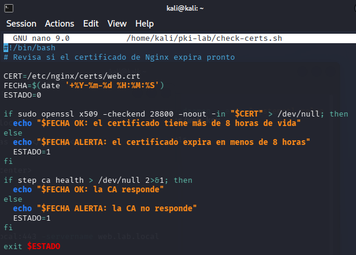
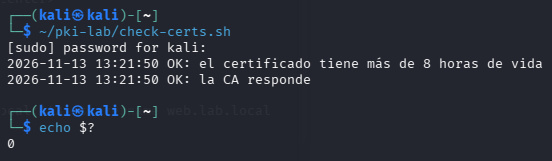
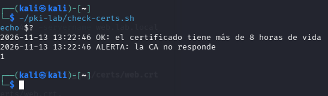
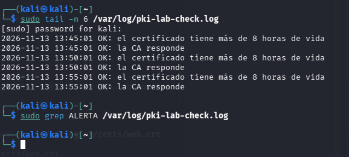

---

## 6. Design decisions

| Decision | Why |
|---|---|
| **Two tiers** (root + intermediate) | If the intermediate is compromised, I revoke it and issue a new one; the root and every device's trust store stay intact. |
| Root **10 years**, intermediate **5 years** | The root is installed in every trust store, so replacing it is expensive; it is used almost never. The intermediate works daily, is more exposed and can be rotated without touching clients. An intermediate can never outlive its root. |
| **No root key on the CA server** | `step-ca` only needs the intermediate key. A stolen root key would let an attacker mint any certificate trusted by every device. |
| **ECDSA P-256** | Modern, small, fast keys; widely supported. |
| **24-hour leaf certificates** | A stolen key is useful for hours, not years (*passive revocation*). Forces automation — the same direction the CA/B Forum is taking public certificates. |
| **ACME** for servers | Standard protocol (RFC 8555), no shared passwords, works with certbot/acme.sh/Caddy. |
| **mTLS** for clients | Strong identity for service-to-service traffic without passwords. |
| **Monitoring with exit codes** | Silent failures become visible; easy to plug into any alerting system. |

**Revoking a client:** revoking at the CA is not enough by itself — Nginx does not ask the CA on every connection. Options: *active revocation* (step-ca's CRL + Nginx `ssl_crl`) for immediate blocking, or *passive revocation* (stop renewing; a 24h certificate dies within hours).

## 7. Security notes

- **No private keys, passwords or CA secrets are in this repository.** `.gitignore` blocks `*.key`, `*_key`, `secrets/`, `.step/` and `ca.json` (which contains the encrypted provisioner key).
- Certificates, fingerprints and serials shown in screenshots are public data.
- **Lab limitation (honest):** the root key lives on the same VM, outside the CA's directory and encrypted. In production it would be offline (an HSM or an air-gapped machine) and used only to sign/rotate intermediates.
- Passwords for keys are stored in a password manager, never typed into commands or shared.

## 8. Problems I hit and lessons learned

| Problem | What I learned |
|---|---|
| Forgot the key passwords after day 1 | Encrypted key passwords **cannot be recovered** — by design. I rebuilt the whole PKI (Nov 13), this time saving passwords in a password manager **before** using them and testing them with `openssl pkey`. |
| `apt install` failed with `404 Not Found` | Kali is rolling; the local package index was stale → `apt update` first. |
| First version of the monitor mixed both checks inside one `if` | Each check needs its own `if … fi`; otherwise the CA check only ran when the certificate was OK and alerts were mislabeled. |
| ACME needs port 80 | Binding <1024 needs root → `sudo env STEPPATH=…` to keep my config. |
| Renewed file but Nginx served the old certificate | Nginx reads certificates only at start/reload → `--exec "systemctl reload nginx"`. |
| Subject vs Issuer confusion | Subject = owner of the certificate; Issuer = who signed it. |

## 9. Repository structure

```
private-pki-lab/
├── README.md                     # this write-up (English)
├── README.es.md                  # write-up in Spanish
├── scripts/check-certs.sh        # expiry + CA health monitor
├── config/nginx/web.conf         # Nginx TLS + mTLS config
├── config/cron/pki-lab-check.cron# monitor schedule
├── docs/evidence/                # screenshots (01–22)
└── .gitignore                    # blocks keys and CA secrets
```

---

**References:** [step-ca docs](https://smallstep.com/docs/step-ca/) · [Use step-ca with an existing PKI](https://smallstep.com/docs/tutorials/intermediate-ca-new-ca) · [ACME basics](https://smallstep.com/docs/step-ca/acme-basics/) · [Certificate renewal](https://smallstep.com/docs/step-ca/renewal) · [Production considerations](https://smallstep.com/docs/step-ca/certificate-authority-server-production/)
